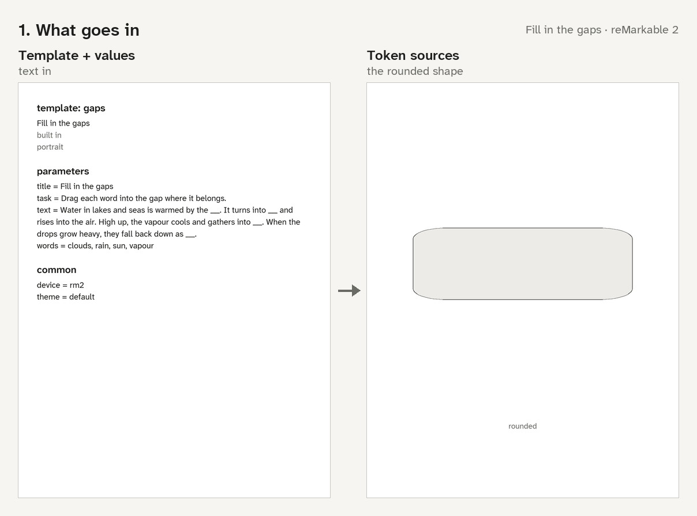
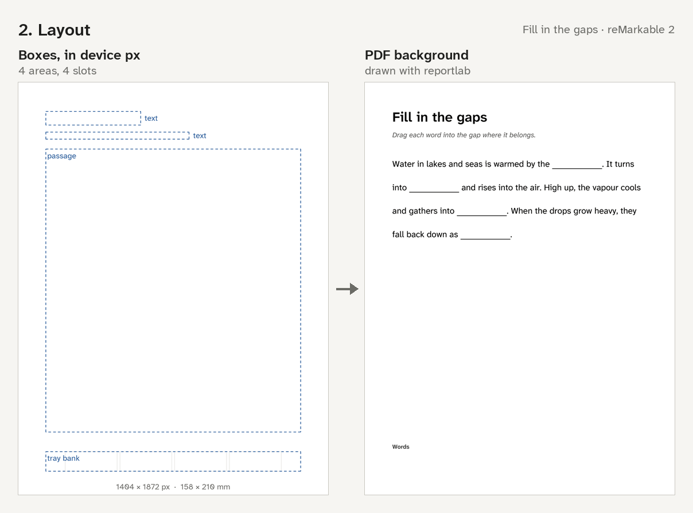
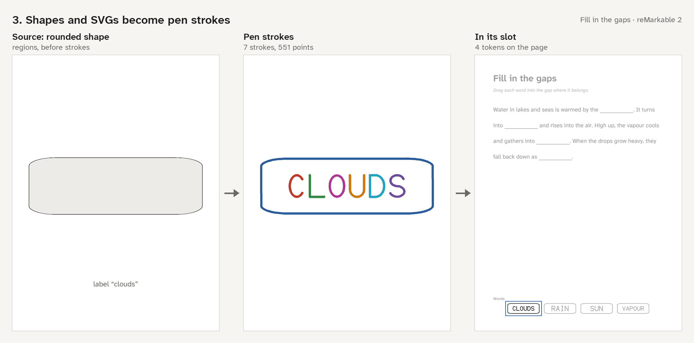
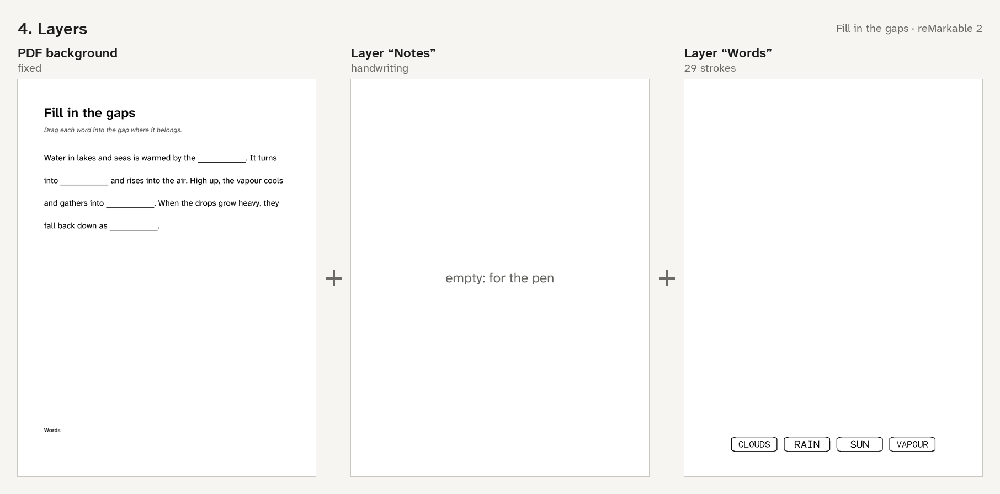
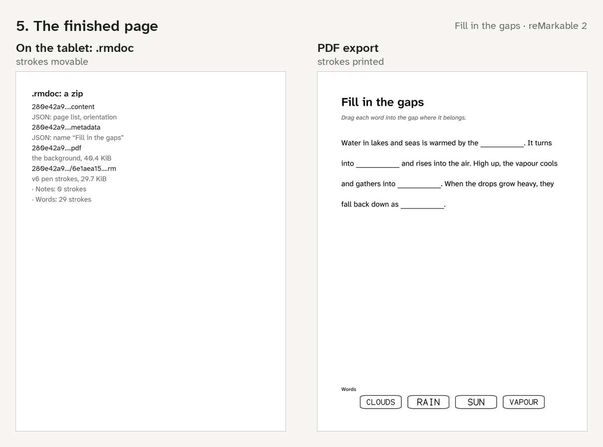
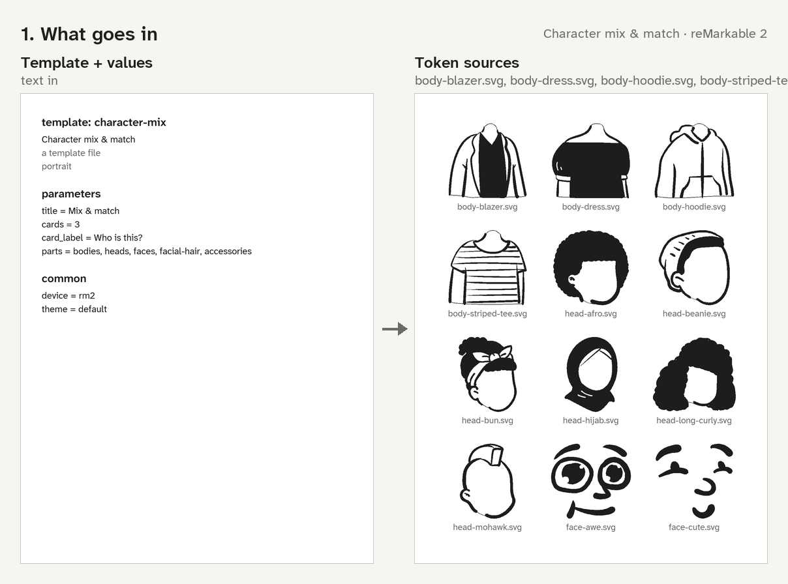
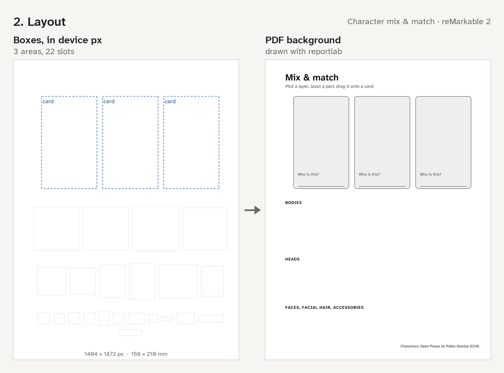
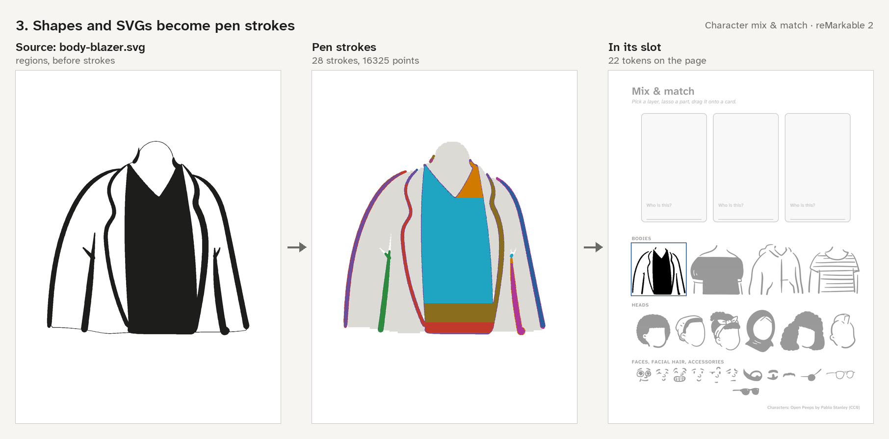
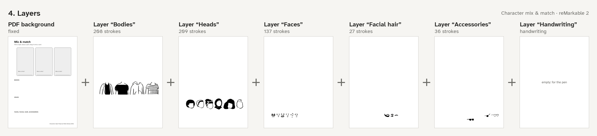
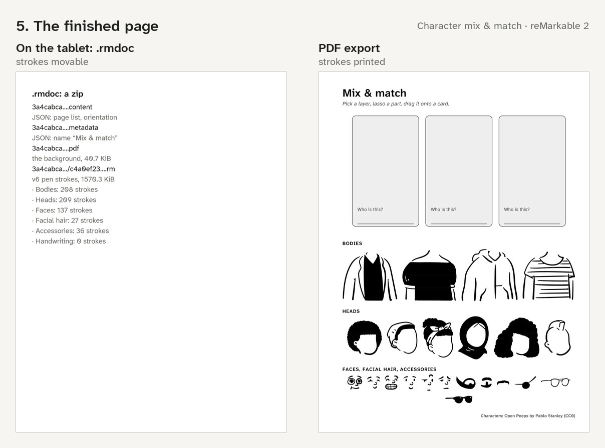

# How a page is built

<!-- Generated by `rmstrokes explain gaps examples/character_mix/character_mix.py -o docs/how-a-page-is-built --markdown docs/how-a-page-is-built.md`: edit the text in src/rmstrokes/explain.py, not here. -->

Every page is a fixed PDF background plus named layers of real pen strokes. A template turns its parameter values (text) and its tokens' shapes or SVG files into both: it lays the page out, draws the background with reportlab, turns each token into one compact cluster of strokes, puts the clusters on layers and writes the result as an `.rmdoc` notebook (strokes movable) or a plain PDF (strokes printed). The pictures below are drawn from the template's own page.

To see the steps for any template: `rmstrokes explain TEMPLATE [--device D] -o DIR` (a name or a `.toml`/`.py` file).

## Fill in the gaps (`gaps`) on the reMarkable 2

### 1. What goes in

A template and its parameter values. `gaps` is built in: a passage with gaps and a bank of word tags to drag into them. It takes 4 parameters of its own (here its defaults) and the five every template has: `device`, `theme`, `name`, `copies` and `intro`. Text comes in as parameter values. The tokens are drawn from the `rounded` shape; a token can also be an SVG file.

### 2. Layout

Everything is placed in device pixels, the unit pen strokes use: 1404 × 1872 px (158 × 210 mm at 226 ppi on the reMarkable 2). The template works out 2 texts, 1 passage and 1 tray, and a slot for each of its 4 tokens (the thin boxes). Then the background is drawn into a PDF page from those boxes; nothing on it can move.

### 3. Shapes and SVGs become pen strokes

Each token turns into pen strokes: its `rounded` shape becomes outline strokes and its label “clouds” is written in a single-line stroke font. This one is 7 strokes with 551 points (one colour per stroke here; white ink shows light grey), written one after another so a single lasso picks the token up as one piece. The page has 4 tokens, 29 strokes in all.

### 4. Layers

The strokes go onto named layers, bottom to top: “Notes” (empty) and “Words” (29 strokes). The PDF background sits under all of them and can't be selected. “Notes” is empty: it's for the pen, so a lasso on a stroke layer never picks up handwriting. On the tablet: pick a layer, lasso, drag.

### 5. The finished page

The page is written two ways. As an `.rmdoc`, a zip of the PDF background, one `.rm` file of v6 pen strokes per page and two small JSON files, the tablet opens it as a notebook and the strokes stay movable. As a plain PDF the strokes are printed onto the background, for any reader or a printer.

## Character mix & match (`character-mix`) on the reMarkable 2

### 1. What goes in

A template and its parameter values. `character-mix` is a template file: build people from parts: bodies, heads, faces, facial hair and accessories as movable pen strokes, a layer per kind, and blank cards with a name line (Open Peeps, CC0). It takes 4 parameters of its own (here its defaults) and the five every template has: `device`, `theme`, `name`, `copies` and `intro`. Text comes in as parameter values. The tokens are drawn from `body-blazer.svg`, `body-dress.svg`, `body-hoodie.svg` and 19 more, SVG files read as vector art.

### 2. Layout

Everything is placed in device pixels, the unit pen strokes use: 1404 × 1872 px (158 × 210 mm at 226 ppi on the reMarkable 2). The template works out 3 cards, and a slot for each of its 22 tokens (the thin boxes). Then the background is drawn into a PDF page from those boxes; nothing on it can move.

### 3. Shapes and SVGs become pen strokes

Each token turns into pen strokes: the SVG `body-blazer.svg` is read into dark and light regions, which become outline strokes and hatching (white-fill). This one is 28 strokes with 16325 points (one colour per stroke here; white ink shows light grey), written one after another so a single lasso picks the token up as one piece. The page has 22 tokens, 617 strokes in all.

### 4. Layers

The strokes go onto named layers, bottom to top: “Bodies” (208 strokes), “Heads” (209 strokes), “Faces” (137 strokes), “Facial hair” (27 strokes), “Accessories” (36 strokes) and “Handwriting” (empty). The PDF background sits under all of them and can't be selected. “Handwriting” is empty: it's for the pen, so a lasso on a stroke layer never picks up handwriting. On the tablet: pick a layer, lasso, drag.

### 5. The finished page

The page is written two ways. As an `.rmdoc`, a zip of the PDF background, one `.rm` file of v6 pen strokes per page and two small JSON files, the tablet opens it as a notebook and the strokes stay movable. As a plain PDF the strokes are printed onto the background, for any reader or a printer.
