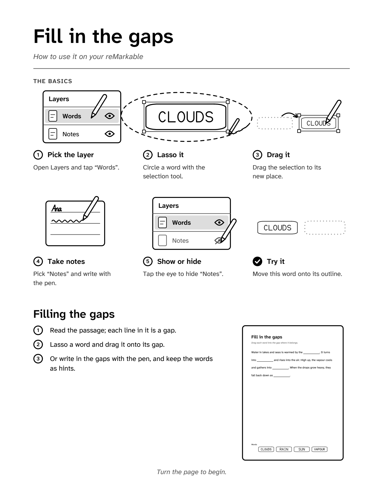
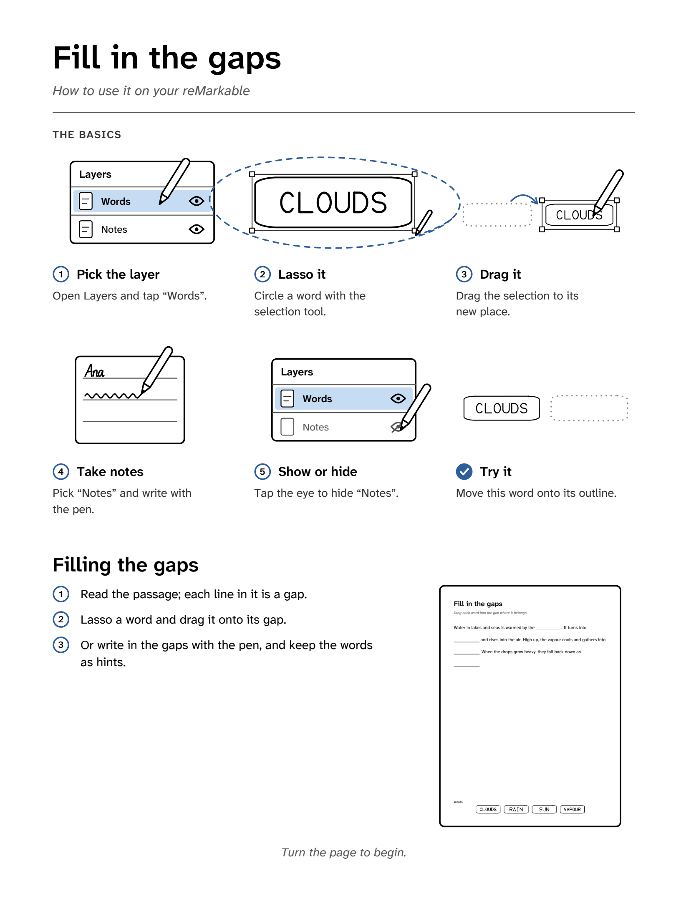
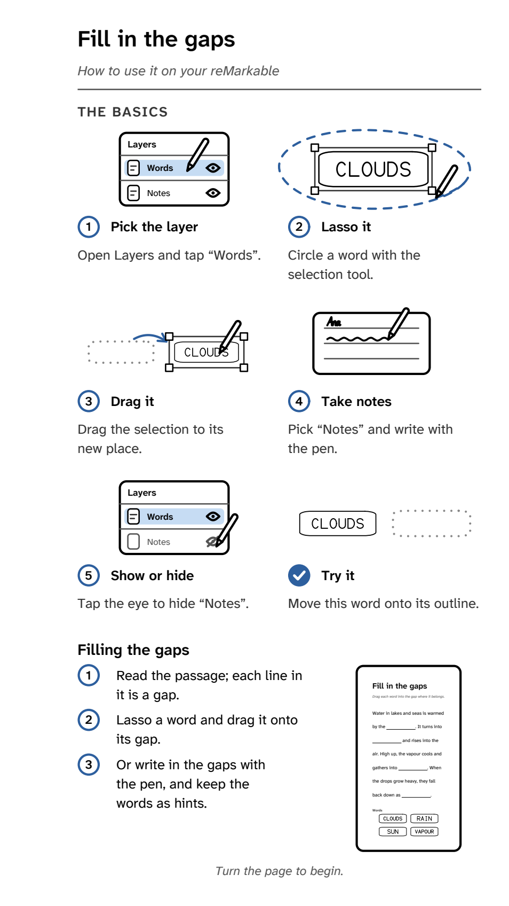

# The intro page

The optional first page of a document (`intro = true` in a recipe, `--intro` on the command line) explains how to use
it on the tablet. Code: [`rmstrokes/intro.py`](../src/rmstrokes/intro.py). Each template's own text is in its
`IntroSpec` (or the `[intro]` table of a data template).

**Status.** Only the reMarkable 2 has been checked on hardware. The Paper Pro colour versions and the Move layout
follow the [design system](design-system.md) rules but are **unverified on device**.

## What it shows

1. **Header**: the document title (`title` role: Source Serif 4, or Atkinson SemiBold
   without a font package), "How to use it on your reMarkable" (`italic`,
   muted), a hairline.
2. **The basics**: six cards in a grid, each a small scene, a numbered title and one short sentence:

   | Card | Scene | Text (example) |
   |---|---|---|
   | 1 Pick the layer | the layer panel, the movable layer selected, a stylus tapping it | Open Layers and tap "Words". |
   | 2 Lasso it | the token, a dashed freehand loop round it, the selection box with handles, the stylus closing the loop | Circle a token with the selection tool. |
   | 3 Drag it | a dotted ghost where it was, a curved arrow, the token selected in its new place | Drag the selection to its new place. |
   | 4 Name it / Take notes | handwriting in the token's tag (or on ruled lines, when the tokens have no tag) | Write a name in the tag, on that layer. |
   | 5 Show or hide | the layer panel, the notes layer's eye struck through | Tap the eye to hide "Writing". |
   | Try it (tick) | the outline to drop on; the token itself is real strokes on the `Practice` layer | Move this pin onto its outline. |

   The token in the scenes is the template's own (`IntroSpec.token`, e.g. `token_maker(Token(...))`; a data template:
   the first token on its intro layer), drawn as its page draws it. A template without one gets a generic numbered
   disc. In a document of several templates the first one that fits
   is used (one with a name tag if any template has name tags), and the text says "token" unless all agree.

3. **The template's own part**: its title (`title` font, smaller), three to five numbered steps, and a miniature of
   its first page, drawn from the page as built for this document (same values, same theme), in a thin rounded frame (beside the steps for a portrait page, below them for a landscape one).
4. **Footer**: "Turn the page to begin."

Portrait pages stack the grid (three columns, two on the Move) above the template's part. Landscape pages put the
grid on the left and the template's part on the right. If the page doesn't fit, the layout scales down in steps, with
text never below 2.5 mm and the scenes flattening last. Then it drops the miniature, then uses one more card column.
If it still doesn't fit, it refuses with "shorten the template steps".

## The illustration rules

- **One line weight**: every outline is `line` (0.4 mm). `hairline` (0.25 mm) is only for inner details (the
  selection box, thumbnail lines). Tokens use the same 0.4 mm pen.
- **One corner radius**: 1.2 mm for the panel, rows, tags and the miniature frame.
- **No boxes behind the scenes.** They sit on white with generous space around them.
- **A stylus in every scene that has an action**, drawn the same way each time, so each scene reads as "do this".
- **Echo the tablet, simplified**: a layer panel with a header, thumbnails, names and eyes; a dashed lasso and a
  selection box with corner handles. No copied artwork, icons or logos.
- **Colour (Paper Pro)**: the first accent (blue, `accent-1`) marks the lasso loop, the motion arrows, the step rings
  and the tick, and `accent-1-tint` fills the selected layer. Text stays in the greys. On the reMarkable 2 the same
  marks are `ink`, and the selected row is `surface` grey. The intro always draws in the system style, `color` on a
  colour tablet and `default` otherwise, whatever the template's own theme (`intro_style`). It is the tablet's how-to
  and should look the same in every document.

## Writing the steps

- **Three to five steps, one short sentence each, verb first**: "Drag each word into the box where it belongs."
- The basics cards already explain the tablet's tools, so a template's steps only say what is special about it: what
  the areas mean, where things start, which layer to write on.
- Name layers in curly quotes, as the tablet shows them: on “Writing”.
- Build the steps from the values in `intro_spec(values)`, so they name what this page shows (names
  the user gave, which options are on, where things start). List other labels a step relies on (group names, "A–Z")
  in `IntroSpec.terms`.
- `name_tags = false` (data templates: derived from whether any token has a `name_tag`) swaps the "Name it" card for
  "Take notes".
- `tests/test_intro.py` checks the page itself: it fits on every device and orientation, nothing overlaps or leaves
  the margins, each card is one short sentence, and too much text is refused. Templates
  should be tested the same way: the intro fits on every device, two to five steps of one sentence each, and every
  label a step names (a quoted layer, an abbreviation in capitals, `terms`) is a layer of the first page or printed
  on it.

## Previews

`uv run rmstrokes gallery` builds every template with its intro page on the reMarkable 2 and the Paper Pro
(`--with-move`: the Move too). The committed previews:

| | | |
|---|---|---|
|  |  |  |
| reMarkable 2 | Paper Pro, colour (unverified on device) | Paper Pro Move (unverified) |
